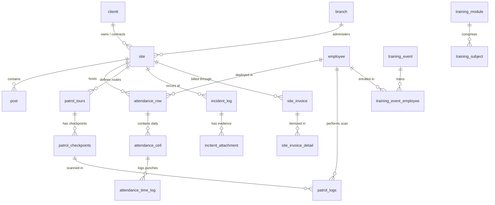

# QRDA Enterprise Portal - Database Tables & Schema Architecture Document

> **Database System:** MySQL  
> **Database Name:** `qrda_test`  
> **Backend Service:** FastAPI REST Engine (`qrda_real_api.py` on port `8001`)  
> **Frontend Application:** QRDA Admin Enterprise Portal (React + Tailwind CSS)

---

## Executive Overview

This document provides a comprehensive, page-by-page mapping of all database tables used by the QRDA Enterprise Application. It describes:
1. **Which page/module uses which table(s)**
2. **The exact business purpose of each table**
3. **Key columns & primary/foreign key relationships**
4. **Data flow between the frontend UI and database layers**

---

## 1. Site Time Logs (`SiteTimeLogsPage.jsx`)

The **Site Time Logs** module provides a compact data workspace displaying day-by-day punch records, shift allocations, overtime, active clock-in markers, and weekly off statuses across an entire calendar month for deployed security personnel.

### Tables Used

| Table Name | Primary Role | Key Columns | Relationship & Description |
|---|---|---|---|
| `attendance_row` | **Monthly Roster Container** | `oid`, `EMPLOYEE`, `ATTENDANCE_SITE`, `yearmonth`, `duty_type`, `created_date` | Links an employee to a specific deployment site for an entire billing month (`yearmonth`). Forms the primary row structure of the attendance grid. |
| `attendance_cell` | **Daily Attendance State** | `oid`, `ATTENDANCE_ROW`, `attendance_date`, `attendance_state`, `overtime_hours`, `late_in_min`, `early_out_min` | Stores the day-level status (e.g. `P` for Present, `IN` for Clocked IN, `WO` for Weekly Off, `A` for Absent) for each calendar day (1 to 28/30/31). |
| `attendance_time_log` | **Precise Timestamps & Punches** | `oid`, `ATTENDANCE_CELL`, `in_time`, `out_time`, `in_gps_lat`, `in_gps_long`, `out_gps_lat`, `out_gps_long`, `mark_work_hours_as` | Contains the actual biometric or mobile app punch timestamps (`in_time`, `out_time`), geo-coordinates at punch, and calculated billable hours. |
| `employee` | **Security Guard Master** | `oid`, `emp_code`, `name`, `mobile`, `active`, `DESIGNATION`, `SITE`, `BRANCH` | Master profile for security personnel. Used for guard names, codes, designations, and active verification. |
| `site` | **Operational Site** | `oid`, `name`, `CLIENTT`, `BRANCH`, `address`, `active` | Master list of corporate locations (e.g. `WIPRO GOPANPALLY ICG GATE HYD`, `PRABHADEVI - AON`). |
| `clientt` | **Client Master** | `oid`, `name`, `short_name`, `pan_no`, `gstin` | Corporate clients owning or contracting the site (e.g. `Wipro`, `AON`, `Tata Communications`). |
| `branch` | **Operating Branch** | `oid`, `name`, `state_id`, `city` | Regional operating branch (e.g. `Hyderabad`, `Mumbai`, `Pune`). |
| `skill_or_designation` | **Rank & Designation** | `oid`, `name`, `code` | Standard ranks such as `S/G` (Security Guard), `LS/G` (Lady Guard), `S/SUP` (Supervisor), `Field Officer`, `Recep`. |
| `weekly_off` | **Weekly Off Schedule** | `OID`, `weekly_off_day` | Identifies which weekday is the guard's scheduled off day (e.g. `Sunday`, `Saturday`). |
| `shift` | **Shift Timing Master** | `oid`, `name`, `start_time`, `end_time`, `duration_hours` | Defines enterprise shifts such as `A-Shift (06:00-14:00)`, `B-Shift (14:00-22:00)`, `C-Shift (22:00-06:00)`, and `General Shift (09:00-18:00)`. |
| `daily_attendance_approval` | **Workflow Sign-off** | `oid`, `attendance_date`, `SITE`, `status`, `approved_by` | Tracks supervisor verification and customer approval before payroll & billing export. |

---

## 2. Employees Directory (`EmployeesPage.jsx`)

The **Employees Directory** manages personnel records, onboarding status, compliance documents, active/released designations, contact info, and app registration status.

### Tables Used

| Table Name | Primary Role | Key Columns | Relationship & Description |
|---|---|---|---|
| `employee` | **Core Personnel Profile** | `oid`, `emp_code`, `name`, `mobile`, `email`, `gender`, `date_of_joining`, `date_of_leaving`, `active`, `app_registered`, `trainee_app_registered` | Master record for each security guard, supervisor, or field officer. |
| `clientt` | **Contracting Client** | `oid`, `name` | Resolves which client company the employee is currently stationed at via `site.CLIENTT`. |
| `branch` | **Regional Branch** | `oid`, `name` | Joined via `employee.BRANCH = branch.oid`. |
| `site` | **Deployment Station** | `oid`, `name` | Joined via `employee.SITE = site.oid`. Shows the employee's designated deployment post. |
| `skill_or_designation` | **Rank & Designations** | `oid`, `name` | Resolves both functional skill designation (`DESIGNATION`) and company rank (`COMPANY_DESIGNATION`). |
| `weekly_off` | **Weekly Rest Day** | `OID`, `weekly_off_day` | Joined via `employee.oid = weekly_off.OID`. |
| `employee_documents` | **KYC & Verification Uploads** | `oid`, `EMPLOYEE`, `document_type_id`, `file_path`, `upload_date`, `verified` | Stores file paths and metadata for Aadhar Card, PAN Card, Police Verification, and Bank Passbook copies. |
| `employee_document_tyep` | **Document Categories** | `oid`, `name`, `is_mandatory` | Lookup table defining mandatory vs optional onboarding documents. |
| `employee_person` | **Personal & Emergency Info** | `oid`, `EMPLOYEE`, `dob`, `blood_group`, `emergency_contact_name`, `emergency_mobile`, `permanent_address` | Extended bio-data and emergency contact information. |
| `employee_payroll_detail` | **Bank & Wage Configuration** | `oid`, `EMPLOYEE`, `bank_name`, `bank_account_no`, `ifsc_code`, `pf_number`, `esic_number`, `uan_number` | Salary payment coordinates and statutory registration numbers. |

---

## 3. Standard Deployment (`DeploymentPage.jsx`)

The **Standard Deployment** view handles site-level post allocation, required guard strength per shift, day-wise coverage (Mon–Fri, Sat, Sun), and automatically detects operational shortfalls or surplus.

### Tables Used

| Table Name | Primary Role | Key Columns | Relationship & Description |
|---|---|---|---|
| `site` | **Site Hierarchy** | `oid`, `name`, `CLIENTT`, `BRANCH` | Master operational site selector. |
| `clientt` & `branch` | **Organizational Trees** | `oid`, `name` | Filter hierarchy for enterprise navigation. |
| `post` | **Station Guard Posts** | `oid`, `name`, `SITE`, `post_type`, `is_critical` | Specific guarding locations within a site (e.g. `Main Gate`, `Basement Parking`, `Server Room`, `Visitor Lobby`). |
| `post_shift_strength` | **Post Strength Rules** | `oid`, `POST`, `SHIFT`, `required_count` | Defines how many guards of which rank must man each post during each shift. |
| `shift_designation_plan` | **Designation Targets** | `oid`, `SITE`, `DESIGNATION`, `total_required` | Required headcount targets by rank (e.g. 10 S/G, 2 S/SUP). |
| `shift_designation_count` | **Day-Type Allotment** | `oid`, `PLAN_ID`, `mon_fri_count`, `sat_count`, `sun_count` | Day-specific staffing matrices accounting for weekend reductions or increases. |
| `daily_post_shift_strength` | **Live Strength Tracking** | `oid`, `SITE`, `date`, `shift_id`, `required`, `actual_deployed`, `shortfall` | Compares scheduled requirements against real-time clocked-in guards to flag unattended posts. |
| `daily_roster` | **Daily Guard Allocation** | `oid`, `date`, `EMPLOYEE`, `POST`, `SHIFT` | Daily duty roster matching specific guards to posts and shifts. |

---

## 4. Command Center / Dashboard (`DashboardOverview.jsx`)

The **Command Center** aggregates operational KPIs across the entire security enterprise: active guard counts, attendance percentages, site coverage, active patrol tours, SOS triggers, and compliance alerts.

### Tables Used

| Table Name | Primary Role | Metrics Computed |
|---|---|---|
| `employee` | **Personnel Status** | Total headcount, Active workforce count, Released employees, Mobile app registration %. |
| `site` | **Site Operations** | Total enterprise sites, Active client installations. |
| `clientt` | **Client Accounts** | Total enterprise contracts managed. |
| `branch` | **Branch Footprint** | Number of active operational territories. |
| `patrol_tours` | **Patrol Execution** | Total scheduled routes for the current day. |
| `patrol_logs` | **Checkpoint Audits** | Completed vs missed checkpoint scans, scan accuracy. |
| `patrol_sos_alerts` | **Security Emergency** | Active unacknowledged SOS panic alerts. |
| `incident_log` | **Threat Management** | Open security incidents categorized by severity (Critical, High, Medium, Low). |

---

## 5. Incident Reports (`IncidentReportsPage.jsx`)

Handles security breaches, safety incidents, perimeter violations, theft reports, and panic alarms with photo attachments and investigation workflows.

### Tables Used

| Table Name | Primary Role | Key Columns | Description |
|---|---|---|---|
| `incident_log` | **Incident Register** | `oid`, `SITE`, `REPORTED_BY_EMPLOYEE`, `incident_category_id`, `incident_date`, `severity`, `title`, `description`, `status`, `resolved_date` | Main ticket table storing reported security occurrences and investigation progress. |
| `incident_category` | **Classification Catalog** | `oid`, `name`, `code`, `default_severity` | Categorizes incidents (e.g. `Theft / Loss`, `Unauthorized Access`, `Fire / Hazard`, `Medical Emergency`, `Geofence Breach`). |
| `incitent_attachment` | **Multimedia Evidence** | `oid`, `INCIDENT_LOG`, `file_path`, `file_type`, `uploaded_at` | Evidence files such as CCTV camera captures, guard photos, and witness statement PDFs. |
| `patrol_sos_alerts` | **Panic Alarm Register** | `oid`, `EMPLOYEE`, `SITE`, `alert_time`, `lat`, `long`, `status`, `acknowledged_by` | Records instantaneous SOS panic button triggers generated from guards' mobile apps. |

---

## 6. Patrol & Geofencing (`PatrolGeofencingPage.jsx`)

Manages NFC/QR-code guard touring, GPS patrol routes, scheduled rounds, checkpoint scans, and geofence boundary compliance.

### Tables Used

| Table Name | Primary Role | Key Columns | Description |
|---|---|---|---|
| `patrol_tours` | **Patrol Routes** | `oid`, `name`, `SITE`, `start_time`, `end_time`, `interval_minutes`, `active` | Master list of named patrol routes configured for a site. |
| `patrol_checkpoints` | **Physical Checkpoints** | `oid`, `TOUR_ID`, `name`, `qr_code_val`, `nfc_tag_id`, `latitude`, `longitude`, `sequence_order` | Physical checkpoints equipped with QR codes, NFC tags, and GPS coordinates. |
| `patrol_logs` | **Scan Logs** | `oid`, `TOUR_ID`, `CHECKPOINT_ID`, `EMPLOYEE`, `scan_timestamp`, `status`, `gps_accuracy` | Verification log captured each time a guard scans a checkpoint tag during rounds. |
| `patrol_shifts` | **Patrol Shift Windows** | `oid`, `name`, `start_time`, `end_time` | Working shifts during which patrols are actively enforced. |
| `duty_location_violations` | **Geofence Violations** | `oid`, `EMPLOYEE`, `SITE`, `violation_time`, `breach_type`, `distance_meters` | Flags instances where a guard left their geofenced perimeter or failed to report to their assigned post. |
| `gps_location_logs` | **Live Location Breadcrumbs** | `oid`, `EMPLOYEE`, `latitude`, `longitude`, `recorded_at`, `battery_level` | High-frequency telemetry providing real-time guard tracking across large facilities. |
| `field_officer_assigned_visits`| **Night / Day Audits** | `oid`, `FIELD_OFFICER`, `SITE`, `scheduled_date`, `visit_type` | Audit visit schedules executed by Field Officers to evaluate post discipline. |
| `site_visit_sessions` | **Inspection Reports** | `oid`, `VISIT_ID`, `in_time`, `out_time`, `checklist_score`, `findings` | Records field audit completion notes and corrective actions. |

---

## 7. Training & LMS (`LmsTrainingPage.jsx`)

The **Learning Management System (LMS)** delivers vocational security training, onboarding tutorials, refresher modules, and guard certification assessments.

### Tables Used

| Table Name | Primary Role | Key Columns | Description |
|---|---|---|---|
| `training_module` | **Course Module Master** | `oid`, `title`, `description`, `code`, `is_mandatory` | High-level course topics (e.g. `Physical Guarding Protocols`, `Fire Safety & Evacuation`, `First Aid`, `VIP Escort`). |
| `training_subject` | **Lesson Curriculum** | `oid`, `MODULE_ID`, `subject_name`, `duration_minutes` | Individual lessons and chapters under each course module. |
| `training_event` | **Training Batches** | `oid`, `training_name`, `start_date`, `end_date`, `LOCATION`, `TRAINER` | Scheduled classroom or field training sessions. |
| `training_event_employee` | **Candidate Enrollment** | `oid`, `EVENT_ID`, `EMPLOYEE`, `enrollment_status` | Enrolls guards into specific training batches. |
| `training_event_attendance` | **Training Attendance** | `oid`, `EVENT_ID`, `EMPLOYEE`, `attendance_date`, `is_present` | Daily session attendance of guards during training courses. |
| `training_question` | **Assessment Question Bank** | `oid`, `SUBJECT_ID`, `question_text`, `marks` | Multiple-choice evaluation questions. |
| `training_question_option` | **Answer Choices** | `oid`, `QUESTION_ID`, `option_text`, `is_correct` | Multiple choices for quiz evaluation. |
| `training_self_test` | **Exam Attempts** | `oid`, `EMPLOYEE`, `MODULE_ID`, `score_percentage`, `passed`, `completed_at` | Stores guard test scores, pass/fail results, and certificate eligibility. |
| `trainer` | **Instructor Directory** | `oid`, `name`, `specialization`, `contact_no` | Certified internal or third-party training instructors. |
| `training_employee_feedback` | **Candidate Feedback** | `oid`, `EVENT_ID`, `EMPLOYEE`, `rating`, `comments` | Guard feedback on instructor clarity and content utility. |

---

## 8. Compliance & Audits (`ComplianceAuditsPage.jsx`)

Ensures statutory compliance with labor laws, minimum wages, PF/ESIC deposits, registers, and client audit packets.

### Tables Used

| Table Name | Primary Role | Key Columns | Description |
|---|---|---|---|
| `doc_company_monthly` | **Statutory Registers** | `oid`, `yearmonth`, `BRANCH`, `doc_type`, `file_path`, `verified` | Monthly statutory records: Form XIX (Wage Register), ECR Challans, ESIC Monthly Contributions, PT Returns. |
| `doc_site_monthly` | **Site Compliance Folders** | `oid`, `SITE`, `yearmonth`, `muster_roll_path`, `wage_sheet_path` | Client-specific muster rolls, overtime registers, and signed wage receipts required for monthly invoicing. |
| `wages_structure` | **Minimum Wage Slabs** | `oid`, `state_id`, `district_id`, `zone`, `designation_id`, `basic_wage`, `vda`, `pf_rate`, `esi_rate` | Government-notified minimum wage structures by state, zone, and skill category. |
| `wages_gov_document` | **Government Gazettes** | `oid`, `state_id`, `effective_date`, `document_path` | Reference PDFs of official minimum wage notifications and labor department gazettes. |
| `esi_zone` | **ESIC Jurisdiction** | `oid`, `state_id`, `zone_name`, `esic_office_code` | Geographic categorization determining ESIC coverage eligibility. |

---

## 9. Invoicing & Payroll (`InvoicingPayrollPage.jsx`)

Generates client bills based on verified site time logs, manages Purchase Orders (POs), shortfalls, SLA penalties, and computes guard salaries.

### Tables Used

| Table Name | Primary Role | Key Columns | Description |
|---|---|---|---|
| `site_invoice` | **Client Invoice Header** | `oid`, `SITE`, `invoice_no`, `billing_month`, `subtotal`, `tax_amount`, `grand_total`, `status`, `due_date` | Main invoice document issued to clients for guarding services. |
| `site_invoice_detail` | **Invoice Line Items** | `oid`, `INVOICE_ID`, `designation`, `billed_hours`, `rate_per_hour`, `total_amount` | Itemized charges detailing regular shift hours, overtime hours, and reliever duty. |
| `site_purchase_order` | **Client Purchase Order** | `oid`, `CLIENTT`, `SITE`, `po_number`, `valid_from`, `valid_to`, `allocated_budget` | Links invoices against active customer purchase orders and tracks contract balance. |
| `site_penalty` & `site_penalty_detail` | **SLA Shortfall Deductions** | `oid`, `INVOICE_ID`, `penalty_type`, `deduction_amount`, `reason` | Penalty deductions incurred due to unfulfilled posts or SLA non-compliance. |
| `attendance_approval` | **Timesheet Sign-offs** | `oid`, `SITE`, `yearmonth`, `client_signature`, `approved_by`, `approved_at` | Official digital approval of hours worked before invoice generation. |
| `employee_payroll_detail` | **Guard Salary Calculation** | `oid`, `EMPLOYEE`, `yearmonth`, `days_worked`, `gross_salary`, `pf_deduction`, `esi_deduction`, `net_salary` | Individual guard payslip generation incorporating monthly attendance records. |

---

## 10. System Settings & Core Hardware (`SystemSettingsPage.jsx`)

Contains master access control, organization definitions, hardware reader configs, and notification templates.

### Tables Used

| Table Name | Primary Role | Key Columns | Description |
|---|---|---|---|
| `user_account` | **Admin & User Logins** | `oid`, `username`, `password_hash`, `role`, `email`, `active`, `last_login` | System user accounts and role-based permissions (Super Admin, Operations Manager, Branch Admin). |
| `biometric_device` | **Biometric Device Master** | `oid`, `SITE`, `device_name`, `device_serial_no`, `ip_address`, `port`, `device_type`, `is_online` | Hardware attendance terminals (Face Recognition, Fingerprint) communicating attendance logs. |
| `site_gate_qrcode` | **Static Security QR Codes**| `oid`, `SITE`, `gate_name`, `qr_token`, `created_date` | Unique dynamic/static QR tokens printed at gates for guard app check-ins. |
| `company` & `company_bank_detail`| **Corporate Entity Profile**| `oid`, `company_name`, `gstin`, `pan`, `account_no`, `ifsc`, `bank_name` | Corporate entity details printed on invoice headers, reports, and compliance forms. |
| `message_template` | **SMS / WhatsApp Templates** | `oid`, `template_code`, `message_body`, `variables` | Pre-approved communication templates for SOS broadcasts, shift reminders, and duty alerts. |

---

## Database ER Diagram & Cross-Module Relationships

---

## Summary Checklist for Developers

1. **Roster & Attendance Operations:** Always query `attendance_row` joined with `attendance_cell` and `attendance_time_log` using `EMPLOYEE` and `yearmonth`.
2. **Hierarchy Navigation:** Follow `clientt` (Client) &rarr; `branch` (Branch) &rarr; `site` (Site) &rarr; `post` (Post).
3. **Designations:** Always join `skill_or_designation` via `employee.DESIGNATION = skill_or_designation.oid`.
4. **Active Filters:** Use `employee.active = 1` and `site.active = 1` to exclude deactivated resources.
5. **No Code Changed:** All existing database engines, APIs, and components remain intact.
